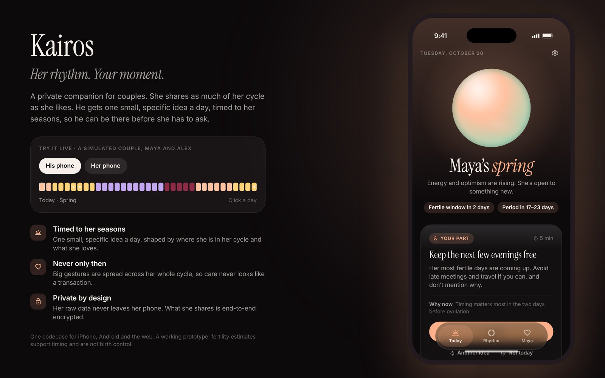
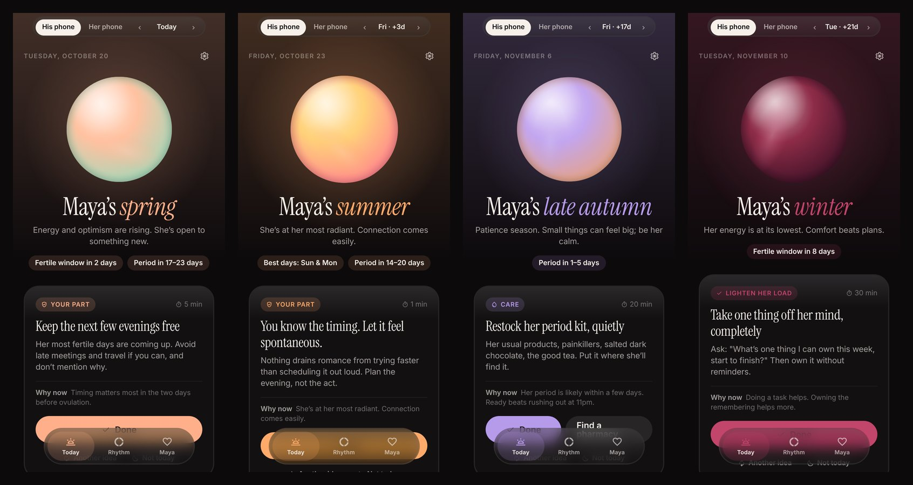
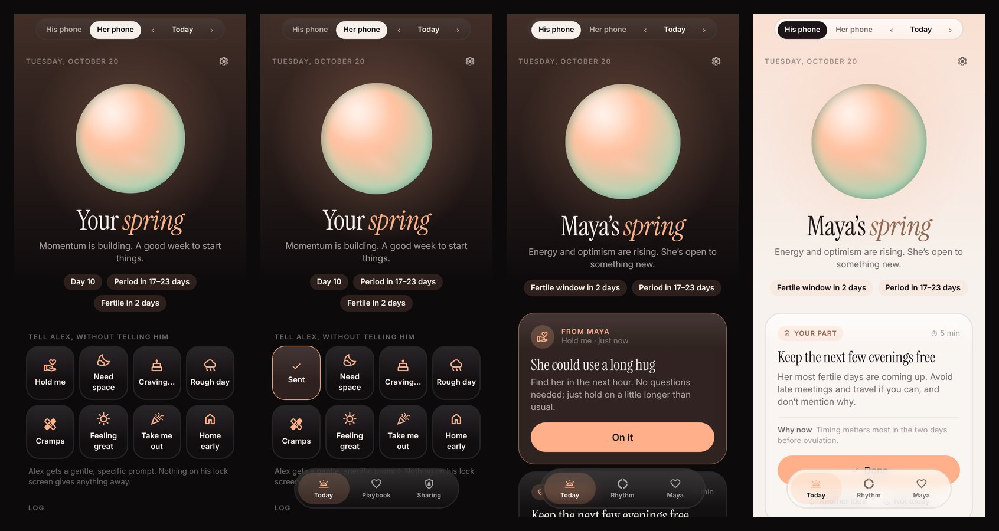

# Kairos

**Her rhythm. Your moment.** A private, cycle-aware companion for couples, for iPhone, Android and the web.

She shares as much of her cycle as she wants. He gets one small, specific idea a day, timed to where she is in her cycle and shaped by what she loves, so he can be there before she has to ask.





## Why it is built this way

The obvious version of this idea (count a week after her period, push him reminders to buy flowers) fails in practice. Calendar counting finds the right ovulation day only about one time in five; gestures that only ever arrive in her fertile week read as a transaction within a few cycles; she controls the data, so if she does not trust it he never gets to use it; and reproductive data is legally dangerous to hold. Kairos is the version that survives those facts:

- **A real forecast.** A Bayesian ovulation model that fuses LH tests, temperature (thermometer or watch) and mucus, with honest uncertainty, reading what she already logs in Apple Health or Health Connect.
- **Seasons, not jargon.** Winter, spring, summer, autumn: a language he understands and a codename that leaks nothing on a lock screen or calendar.
- **Never only then.** The planner spreads big gestures across her whole cycle and caps them inside her fertile days. It is a tested constraint, not a guideline.
- **Her voice.** Eight one-tap signals ("Hold me", "Rough day", "Home early"…) that override the forecast, a playbook in her words, three share levels, and an instant pause.
- **Private by design.** Her raw data never leaves her phone; what she shares is end-to-end encrypted; the relay stores only ciphertext.

Read the full concept in [docs/CONCEPT.md](docs/CONCEPT.md).

## What is in this repository

| Path | What it is |
| --- | --- |
| [`packages/core`](packages/core) | The engine, in dependency-light TypeScript shared by every platform: cycle history and Bayesian ovulation model, Monte Carlo forecast, seasons, a 70+ idea nudge library and planner, her signals, the share-level snapshot, X25519 / XChaCha20-Poly1305 pairing and envelopes, discreet calendar export, a cycle simulator and an accuracy benchmark. 71 tests |
| [`apps/app`](apps/app) | The app: Expo SDK 58 and Expo Router, one codebase for iOS, Android and the web. Onboarding for both partners, his Today / Rhythm / her-playbook screens, her Today / Playbook / Sharing screens, a demo couple with time travel, local notifications, calendar sync, HealthKit and Health Connect import, an iOS widget, and a desktop website shell |
| [`supabase`](supabase) | The ciphertext-only relay: Postgres schema with row-level security and retention, and an Edge Function with mailbox-token auth and content-free wake-up pushes |
| [`docs`](docs) | [Concept](docs/CONCEPT.md) · [Science](docs/SCIENCE.md) · [Privacy](docs/PRIVACY.md) · [Design](docs/DESIGN.md) · [Business](docs/BUSINESS.md) |



## Run it

Requirements: Node 22 and pnpm 10.

```bash
pnpm install
pnpm test            # 71 engine, crypto and relay tests
pnpm bench           # forecast accuracy on simulated cycles (~1 min)
pnpm web             # the app in a browser; tap "Explore the demo"
pnpm app             # Expo dev server; press i / a for simulators
```

The demo needs no account and no server: a simulated couple, Maya and Alex, with a bar to switch phones and move through her cycle. On a wide screen the web app becomes the website, with the live app in a phone frame and a scrubber through her cycle.

Native builds use Expo's continuous native generation (no `ios/` or `android/` folders are committed). HealthKit, Health Connect, the widget and the camera scanner need a development build:

```bash
cd apps/app
npx expo run:ios            # or: npx eas-cli build --profile development
```

Real pairing between two phones needs the relay:

```bash
supabase db push                                # supabase/migrations
supabase functions deploy relay --no-verify-jwt
# then, in apps/app/.env.local
EXPO_PUBLIC_RELAY_URL=https://<project>.supabase.co
EXPO_PUBLIC_RELAY_ANON_KEY=<publishable key>
```

## Verification status

| Check | Status |
| --- | --- |
| Engine, crypto and relay protocol tests | 71 passing (`pnpm test`) |
| TypeScript, engine and app | Clean |
| Web build | Builds; every screen exercised in Chromium at phone and desktop sizes, light and dark |
| iOS and Android JavaScript bundles | Build (`expo export --platform ios --platform android`); the widget compiles to its SwiftUI layout string; HealthKit code is only in the iOS bundle and Health Connect only in Android |
| Relay schema | Migration run on Postgres (PGlite): constraints, pruning, retention, cascade delete and `anon` denial verified |
| Native binaries on devices | **Not yet run.** Needs Xcode / Android Studio or EAS; no Mac was available here |
| Relay deployed | **No.** Code and migration are ready; deploying needs your Supabase project |

## Accuracy, in one table

400 simulated women, six cycles of history each, scored in real time on three more cycles (details and caveats in [SCIENCE.md](docs/SCIENCE.md)):

| Data she logs | Both best days flagged on the morning | Ovulation located within ±1 day |
| --- | --- | --- |
| Period dates only | 57% | 37% |
| + LH tests | 80% | 89% |
| + LH tests + mucus | 89% | 95% |
| Everything | 90% | 98% |

Kairos is a prototype. Fertility estimates support timing; they are not birth control.
