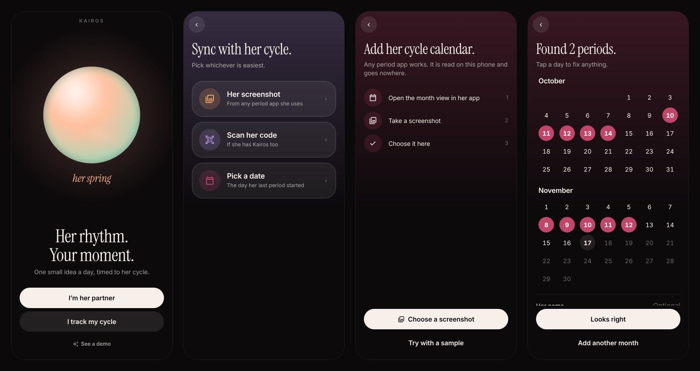
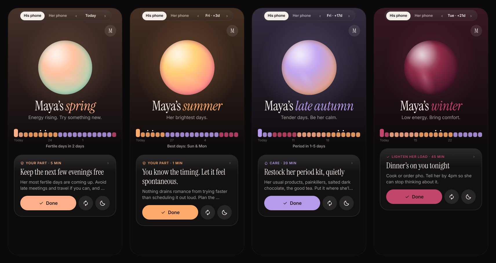
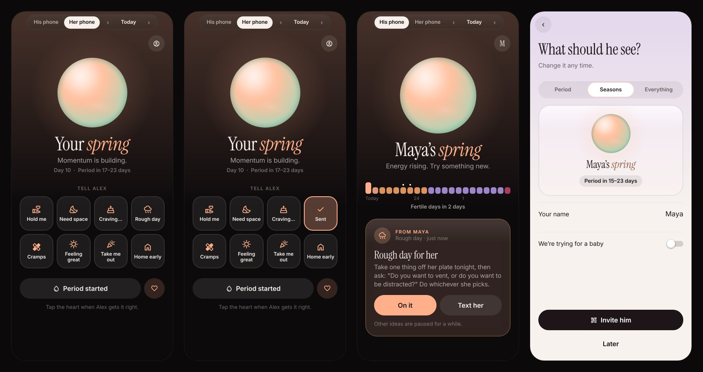
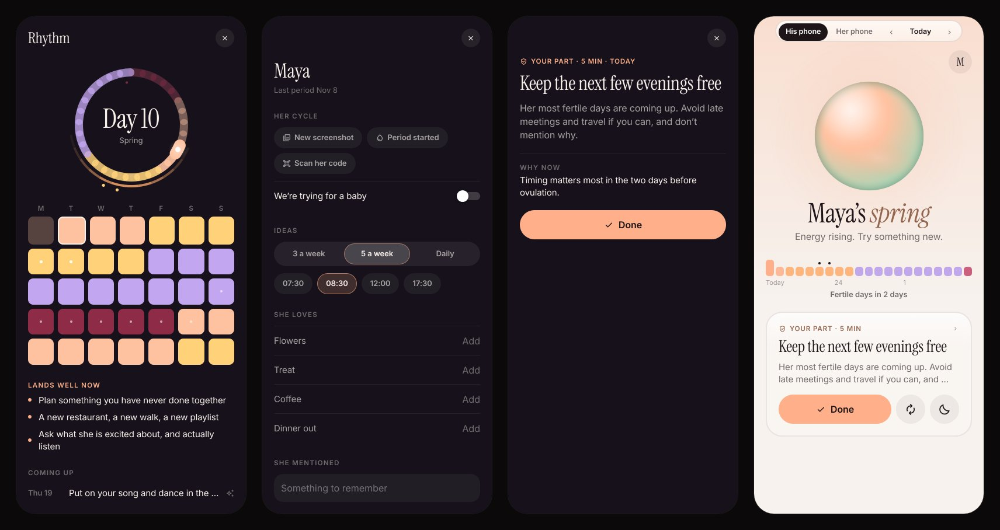

# Tender

**Her rhythm. Your moment.** A private, cycle-aware companion for couples, for iPhone, Android and the web.

He gets one small, specific idea a day, timed to where she is in her cycle, so he can be there before she has to ask. It starts from a screenshot of whatever period app she already uses.





## Why it is built this way

The obvious version of this idea (count a week after her period, push him reminders to buy flowers) fails in practice. Calendar counting finds the right ovulation day only about one time in five; gestures that only ever arrive in her fertile week read as a transaction within a few cycles; and an app that needs both partners to install it before either gets anything rarely gets installed at all. Tender is the version that survives those facts:

- **Works with any tracker.** A screenshot of her calendar is read on the phone, with no server and no OCR model, and shown back as a calendar he can correct with a tap. Or he picks one date.
- **One screen.** His Today is an orb, a season, a ribbon of the next three weeks and one idea. Everything else is one tap down. No tabs.
- **Seasons, not jargon.** Winter, spring, summer, autumn: a language he understands and a codename that leaks nothing on a lock screen or calendar.
- **Never only then.** The planner spreads big gestures across her whole cycle and caps them inside her fertile days. It is a tested constraint, not a guideline.
- **Better together.** If she installs it too, she gets eight one-tap signals that override the forecast, a say in what he sees, an instant pause, and a forecast that can use LH tests, temperature and mucus. What she shares is end-to-end encrypted; the relay stores only ciphertext.

Read the full concept in [docs/CONCEPT.md](docs/CONCEPT.md).

## What is in this repository

| Path | What it is |
| --- | --- |
| [`packages/core`](packages/core) | The engine, in dependency-light TypeScript shared by every platform: the screenshot reader and a small PNG decoder, cycle history and Bayesian ovulation model, Monte Carlo forecast, seasons, a 70+ idea nudge library and planner, her signals, the share-level snapshot, X25519 / XChaCha20-Poly1305 pairing and envelopes, discreet calendar export, a cycle simulator and two benchmarks. 100 tests |
| [`apps/app`](apps/app) | The app: Expo SDK 58 and Expo Router, one codebase for iOS, Android and the web. Two editions from one build switch: solo (his phone only) and paired (both phones). Setup from a screenshot, a pairing code or a date; one Today screen each; rhythm, profile and idea detail as sheets; a demo couple with time travel; local notifications, calendar sync, HealthKit and Health Connect import, an iOS widget, and a desktop website shell |
| [`supabase`](supabase) | The ciphertext-only relay for the paired edition: Postgres schema with row-level security and retention, and an Edge Function with mailbox-token auth and content-free wake-up pushes |
| [`site`](site) | Privacy policy and support pages, ready to host |
| [`docs`](docs) | [Concept](docs/CONCEPT.md) · [Science](docs/SCIENCE.md) · [Privacy](docs/PRIVACY.md) · [Design](docs/DESIGN.md) · [Business](docs/BUSINESS.md) · [App Store runbook](docs/APP_STORE.md) |





## Run it

Requirements: Node 22 and pnpm 10.

```bash
pnpm install
pnpm test                                        # 100 engine, reader, crypto and relay tests
pnpm bench                                       # forecast accuracy on simulated cycles (~1 min)
pnpm --filter @kairos/core bench:calendars       # screenshot reader against rendered calendars (needs Chromium)
pnpm web                                         # the app in a browser
pnpm app                                         # Expo dev server; press i / a for simulators
```

In the browser, tap **I'm her partner → Her screenshot → Try with a sample** to watch the reader work without a screenshot to hand, or **See a demo** for a simulated couple, Maya and Alex, with a bar to switch phones and move through her cycle. On a wide screen the web app becomes the website, with the live app in a phone frame.

Native builds use Expo's continuous native generation (no `ios/` or `android/` folders are committed). HealthKit, Health Connect, the widget and the camera scanner need a development build:

```bash
cd apps/app
npx expo run:ios            # or: npx eas-cli build --profile development
```

The default build is the solo edition. The paired edition (her side, pairing, signals, Health import) switches on when the relay is configured:

```bash
supabase db push                                # supabase/migrations
supabase functions deploy relay --no-verify-jwt
# then, in apps/app/.env.local
EXPO_PUBLIC_RELAY_URL=https://<project>.supabase.co
EXPO_PUBLIC_RELAY_ANON_KEY=<publishable key>
```

Getting it onto the App Store is covered step by step in [docs/APP_STORE.md](docs/APP_STORE.md).

## Verification status

| Check | Status |
| --- | --- |
| Engine, reader, crypto and relay protocol tests | 100 passing (`pnpm test`) |
| TypeScript, engine and app | Clean |
| Screenshot reader | 530 of 540 rendered look-alike calendars read exactly; 9 of the rest flagged for checking, 1 not. **Not yet run on real screenshots from real apps** |
| Web build | Builds; setup from a date, from a sample screenshot and from an image file, the demo, both sides and every sheet exercised in Chromium at phone and desktop sizes, light and dark |
| iOS and Android JavaScript bundles | Build to Hermes bytecode (`expo export --platform ios --platform android`); HealthKit code is only in the iOS bundle and Health Connect only in Android |
| App configuration | Resolves for both editions (`expo config`); the solo edition carries no camera or health capabilities |
| Relay schema | Migration run on Postgres (PGlite): constraints, pruning, retention, cascade delete and `anon` denial verified |
| Native build, simulator, devices | **Not run.** Needs a Mac with Xcode; none was available here |
| App Store submission | **Not done.** Listing, privacy pages and a runbook are ready; the account, the build and the upload are yours ([docs/APP_STORE.md](docs/APP_STORE.md)) |
| Relay deployed | **No.** Only the paired edition needs it |

## Accuracy, in one table

400 simulated women, six cycles of history each, scored in real time on three more cycles (details and caveats in [SCIENCE.md](docs/SCIENCE.md)):

| Data she logs | Both best days flagged on the morning | Ovulation located within ±1 day |
| --- | --- | --- |
| Period dates only (all a screenshot gives) | 57% | 37% |
| + LH tests | 80% | 89% |
| + LH tests + mucus | 89% | 95% |
| Everything | 90% | 98% |

Tender is a prototype. Fertility estimates support timing; they are not birth control.
