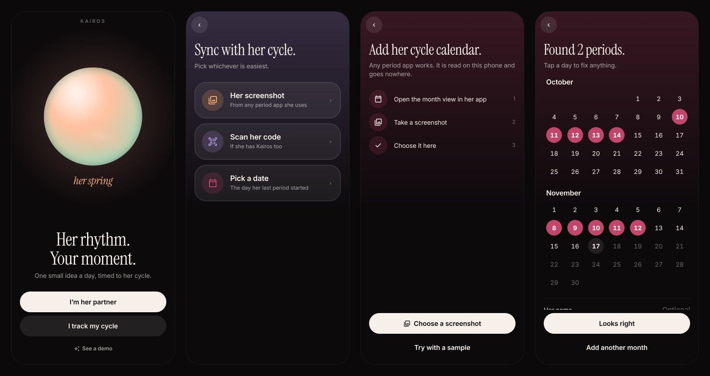

# Kairos app

Expo SDK 58 · Expo Router · React Native 0.88 · one codebase for iOS, Android and the web.



## Structure

```
app.json, app.config.ts  static config, plus the switch between the solo and paired editions
eas.json                 build profiles
store.config.json        App Store listing (EAS Metadata)
src/
  app/                   routes (Expo Router)
    welcome.tsx          the first screen
    setup/               him.tsx (three ways in) · her.tsx (cycle source) · share.tsx (what he sees)
    import.tsx           her cycle from a screenshot or a date, shown as a calendar to confirm
    scan.tsx, pair.tsx   pairing by code or by link (paired edition)
    today.tsx            the app: his Today or hers
    rhythm.tsx           sheet: cycle ring, weeks ahead, what is planned
    profile.tsx          sheet: her name, sharing, how ideas arrive
    nudge.tsx            sheet: an idea in full
    invite.tsx           sheet: her pairing code
  screens/               him-today.tsx · her-today.tsx
  state/
    store.ts             persisted state (zustand + AsyncStorage, never throws)
    kairos.ts            forecast → snapshot → plan, computed once for the tree
    effects.ts           notifications, widget, encrypted sync
    demo.ts              the simulated couple
  platform/              native integrations, split by platform file
    screenshot.ts        choose an image, shrink it, hand pixels to the reader (.web: canvas)
    sample.web.ts        draws a sample tracker calendar so the web demo can show the reader working
    health.ios.ts        HealthKit (read-only)
    health.android.ts    Health Connect (read-only)
    notifications.ts     local scheduling, actionable categories
    calendar.ts          local "Seasons" calendar (.web: .ics file)
    relay.ts             encrypted pairing and messaging client
  ui/                    design system: theme, text, glass, orb, ring, day strip, month grid, controls, sheet, showcase
  widgets/               iOS WidgetKit widget via expo-widgets
```

## Commands

```bash
pnpm start                          # dev server
pnpm web                            # browser
pnpm typecheck
npx expo export --platform web      # static site in dist/
node scripts/build-showcase.mjs     # dist/ packed into one self-contained HTML file
```

## Notes

- There are no tabs. Today is the app; Rhythm and the profile are native form sheets on iOS and full pages elsewhere.
- `ui/glass.tsx` uses real Liquid Glass where available, a frosted blur on older iOS and the web, and tonal surfaces on Android.
- On screens 980 px and wider, `ui/showcase.web.tsx` turns the web app into the website: pitch on the left, the live app in a phone frame on the right.
- **Editions.** With no relay configured the build is the solo edition: his phone only, no camera, no health capabilities, no network. Set `EXPO_PUBLIC_RELAY_URL` and `EXPO_PUBLIC_RELAY_ANON_KEY` for the paired edition; `app.config.ts` then adds the camera, HealthKit and Health Connect plugins.
- Shipping: see [docs/APP_STORE.md](../../docs/APP_STORE.md).
