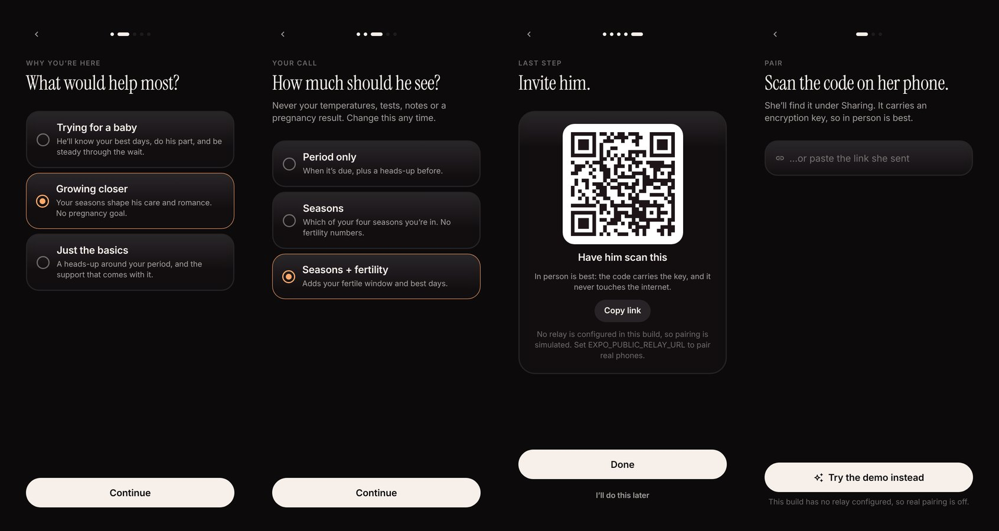

# Kairos app

Expo SDK 58 · Expo Router · React Native 0.88 · one codebase for iOS, Android and the web.



## Structure

```
src/
  app/                 routes (Expo Router)
    welcome.tsx        first screen: choose her side or his, or explore the demo
    onboarding/        her.tsx (5 steps) and him.tsx (3 steps)
    him/               Today · Rhythm · her playbook (as he sees it)
    her/               Today (signals, log) · Playbook · Sharing
    nudge.tsx          an idea in full (sheet)
    settings.tsx       his cadence, budget, weekend, lock-screen detail; her pregnancy-test flow
  state/
    store.ts           persisted state (zustand + AsyncStorage, never throws)
    kairos.ts          forecast → snapshot → plan, computed once for the tree
    effects.ts         notifications, widget, encrypted sync
    demo.ts            the simulated couple
  platform/            native integrations, split by platform file
    health.ios.ts      HealthKit (read-only)
    health.android.ts  Health Connect (read-only)
    notifications.ts   local scheduling, actionable categories
    calendar.ts        local "Seasons" calendar (.web: .ics file)
    relay.ts           encrypted pairing and messaging client
  ui/                  design system: theme, text, glass, orb, ring, controls, tabs, showcase
  widgets/             iOS WidgetKit widget via expo-widgets
```

## Commands

```bash
pnpm start                          # dev server
pnpm web                            # browser
pnpm typecheck
npx expo export --platform web      # static site in dist/
node scripts/build-showcase.mjs     # dist/ packed into one self-contained HTML file
```

## Notes

- `NativeTabs` gives the system tab bar on iOS (Liquid Glass on iOS 26) and Material bottom navigation on Android; the web uses a floating glass capsule (`ui/tabs.web.tsx`).
- `ui/glass.tsx` uses real Liquid Glass where available, a frosted blur on older iOS and the web, and tonal surfaces on Android.
- On screens 980 px and wider, `ui/showcase.web.tsx` turns the web app into the website: pitch on the left, the live app in a phone frame on the right.
- Configure the relay with `EXPO_PUBLIC_RELAY_URL` and `EXPO_PUBLIC_RELAY_ANON_KEY`. Without them, real pairing is off and the demo is the way in.
