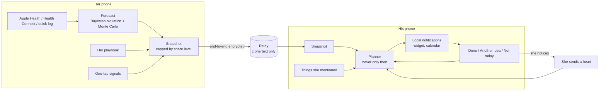

# Kairos: product concept

> **Her rhythm. Your moment.**
> A private companion for couples. She shares as much of her cycle as she wants. He gets one small, specific idea a day, timed to where she is in her cycle and shaped by what she loves, so he can be there before she has to ask.

*Kairos* is the ancient Greek word for the right, opportune moment, as opposed to *chronos*, clock time. The whole product is an argument that good timing is a form of care.

---

## 1. Start with what is wrong with the original brief

The brief: women have fertile days, men have no idea when they are, so build an app that syncs her fertile days to his calendar and nudges him (flowers, perfume, attention, intimacy) so he can "capitalize". The instinct underneath is sound. Taken literally, it would fail, for six reasons.

**1. "About a week after her period ends" is closer to a coin flip than a schedule.** Only about 13% of real cycles are 28 days long; the average is 29.3, and the follicular phase alone ranges from roughly 10 to 30 days (Bull et al. 2019, 612,613 cycles). In a prospective study, only about 30% of women had their fertile window entirely inside the "textbook" days 10–17 (Wilcox, Dunson & Baird 2000). Calendar-only apps place ovulation on the right day roughly one time in five. Our own engine, on simulated cycles, hits the exact day 14% of the time from the calendar alone. An app that counts days would send him to the wrong week a lot of the time. Forecast quality is the product's moat; it is not a detail.

**2. Gestures concentrated in her fertile week will be decoded as a transaction.** Flowers that only ever arrive in the same week of every month are a pattern she will notice within two or three cycles. After that every gesture reads as a means to an end, and the product has made the relationship worse. Kairos is built around the opposite rule, **never only then**: care runs through her whole cycle, big gestures are capped inside her fertile days and actively encouraged outside them, and the planner enforces it as a hard constraint (see `packages/core/src/nudges/planner.ts`).

**3. She is the gatekeeper. Without her, there is no product.** The data is hers, the consent is hers, and she can unpair with one tap. A "men's app" that treats her cycle as an input will be deleted the day she sees it. So Kairos is designed for her first: it gives her a voice (one-tap signals), control (three share levels, instant pause), support she does not have to ask for, and a partner who is visibly more attentive. If she does not love it, he never gets to use it.

**4. If they are not trying for a baby, nudging intimacy toward peak fertility raises the odds of an unplanned pregnancy.** The app therefore asks *why* they are here. "Trying for a baby", "Growing closer" and "Just the basics" lead to different forecasts on his phone, different nudges, and different defaults for what he can see. Fertility estimates help timing; they are not birth control, and the product says so wherever it matters.

**5. Reproductive data is now legally dangerous.** In the US, period-tracking data can be subpoenaed in states that restrict abortion. The FTC has acted against Flo Health (2021) and Premom (2023) over health-data sharing, and in August 2025 a federal jury found that Meta violated California's privacy law by collecting Flo users' data. "We take privacy seriously" is not enough. Kairos is end-to-end encrypted, keeps her raw data on her phone, and runs a relay that stores only ciphertext. See `PRIVACY.md`.

**6. An app will not reverse falling birth rates.** Global fertility fell from about 4.8 children per woman in 1950 to roughly 2.2 in 2021 and is forecast at 1.83 by 2050 (GBD 2021, *Lancet* 2024). The UAE, where this project starts, was at about 1.2 in 2023. The drivers are structural: education, careers, housing, childcare costs, later marriage and chosen family size. What an app *can* do is narrower and real: help couples who want children time things well, keep trying from draining the romance out of the relationship, and prompt them to see a doctor at 12 months (6 if she is 35 or older) instead of drifting. About one adult in six experiences infertility at some point (WHO 2023), so even that narrow job matters.

**What the brief gets right.** Men genuinely do not know where their partner is in her cycle, and many women would like them to. Intercourse frequency rises during the fertile days even without anyone tracking them, by about 24% in one hormone-verified study (Wilcox et al. 2004), so the window is a natural high point for closeness. Couples who do new things together report better relationships (Aron et al. 2000). And for couples trying to conceive, intercourse every one to two days in the fertile window is the evidence-based recommendation (ASRM 2021). The opportunity is real. It needs a better shape.

---

## 2. The reframe

| The brief said | Kairos does |
| --- | --- |
| Track her fertile days | Forecast her **whole** cycle, with honest uncertainty, from the data she already has |
| Sync them to his calendar | Put **codenamed seasons** (Winter, Spring, Summer, Autumn) in his calendar, all-day and marked free |
| Nudge him to please her during those days | One idea a day, **across the whole cycle**, shaped by her season and her own playbook, with a crescendo, never a cliff, around her fertile days |
| Flowers, perfume, gifts | Six ingredients of feeling loved: presence, words, service, small gifts, touch and new experiences, weighted by what *she* says matters |
| Push notifications | Discreet, scheduled locally on his phone, with lead time when a gesture needs preparing. Nothing on the lock screen reveals her cycle |
| His tool | **Their** tool. She writes the playbook, sends signals and decides what he sees |

### Why seasons

"Luteal phase" means nothing to most men and is the last thing anyone wants on a lock screen. Four seasons map onto the cycle intuitively: winter is the bleed, spring is rising energy, summer is ovulation, autumn is winding down, with a "late autumn" for the premenstrual days. The metaphor was popularised by Alexandra Pope and Sjanie Hugo Wurlitzer (*Wild Power*, 2017). It gives him a language and gives the app a codename that leaks nothing.

Seasons describe tendencies, not rules. Prospective studies of mood across the cycle are mixed: of 47 reviewed by Romans et al. (2012), only about 15% found negative mood confined to the premenstrual phase. That is why her signals always override the season.

---

## 3. Three reasons to be here

| | Trying for a baby | Growing closer | Just the basics |
| --- | --- | --- | --- |
| Default share level | Seasons + fertility | Seasons | Period only |
| What he sees | Seasons, fertile window, best days | Seasons | Period forecast and a premenstrual heads-up |
| Extra nudges | His own part: clear your evenings, keep it spontaneous, every day or two is plenty, be steady through the two-week wait, be there on test day, be gentle if her period comes | Romance weighted toward summer, care toward winter | Care and service around her period |
| Guardrails | Never "scheduled sex" language; the timing stays his private knowledge | Fertility shown only if she opts in, with a plain "not birth control" note | Hidden phases stay hidden; only broadly applicable ideas are planned |

**Share levels** cap what leaves her phone, not just what he is shown (`packages/core/src/share/snapshot.ts`):

- **Period only**: bleeding forecast and premenstrual heads-up.
- **Seasons**: every day's season, no fertility numbers.
- **Seasons + fertility**: adds fertile probabilities and best days.

Never shared at any level: temperatures, test results, symptoms, notes, and a pregnancy test result. A positive test pauses sharing quietly so the news is hers to tell. A late period is never shown to him as "late"; it is "any day now".

---

## 4. The two people

### Her

She wants support without having to manage it, and to be read without having to explain. What Kairos gives her:

- **A voice without a confrontation.** Eight one-tap signals: *Hold me, Need space, Craving…, Rough day, Cramps, Feeling great, Take me out, Home early.* He gets a specific, kind prompt within seconds; nothing on his lock screen gives it away. "Need space" and "Cramps" also quiet his other ideas for a while.
- **A partner who gets ahead of things.** Her period kit restocked before it starts, dinner handled on day one, reassurance in late autumn, plans that land on her best days.
- **Control.** Share level, intent, pause (he sees "paused", nothing else), unpair (erases keys on both phones).
- **Surprise mode.** She knows he has an idea today; she does not see what it is.
- **A thank-you button.** "He did something lovely" sends him a heart. It is the strongest learning signal the planner has.
- **Zero extra tracking.** She keeps using Apple Health, Health Connect, her watch, her ring, her LH kit. Kairos reads them; she logs nothing twice.

### Him

He wants to be good at this and does not want a biology lecture. What Kairos gives him:

- **Clarity.** "Maya's late autumn. Patience season. Small things can feel big; be her calm." One line, no jargon.
- **One idea a day, at most.** Specific, doable, timed: *Clear the kitchen before she gets to it. Restock her period kit, quietly. Book a table somewhere neither of you has tried.* With rest days on purpose.
- **Lead time.** Gestures that need preparing arrive early: a table booked three days ahead, flowers ordered the day before, morning gestures announced the evening before.
- **A memory.** "She mentioned her sister's interview" takes five seconds to save and comes back as an idea days later, when following up means the most.
- **Discretion.** Codenames in his calendar, vague lock-screen text by default ("A little idea for today · Takes about 15 minutes"), nothing that embarrasses either of them if a colleague glances at his phone.

---

## 5. Core loops

1. **The daily idea loop.** Her forecast becomes a snapshot, the snapshot becomes his plan, the plan becomes one notification, he marks it done, and the planner learns which kinds of gesture he completes.
2. **The signal loop.** She taps, he gets a specific prompt, he taps "On it". Signals beat seasons, always.
3. **The heart loop.** When she notices something, one tap tells him. It is the only feedback that measures what matters: whether she felt it.
4. **The memory loop.** What she mentions in passing returns as an idea at the right moment.
5. **The ambient loop.** Codenamed seasons in his calendar and on his home and lock screen, so he knows the weather without opening the app.

---

## 6. A cycle in the life of Maya and Alex

This is the demo couple in the prototype, with the ideas the planner actually generated for them. They are trying for a baby; Maya shares seasons and fertility.

| Day | Maya | Alex's idea |
| --- | --- | --- |
| Late autumn | Tired, a little short-fused | *Restock her period kit, quietly.* Her usual products, painkillers, salted dark chocolate, the good tea. |
| | | *Reassure her out of nowhere.* "I'm on your side. Always." |
| | | *If she tests this week, be there for it.* Make the morning about her, not the result. |
| Winter, day 1 | Period arrives | *If her period comes today, be gentle.* For anyone trying, it can feel like a small loss. Don't say "next month". |
| Winter | | *Listen without fixing.* *Run her a bath.* *Dinner's on you tonight: pho.* |
| Spring | Energy back | *Have peonies delivered to her* (the one big gesture, placed **outside** her fertile days). *Take her on an evening walk.* |
| Spring, two days before | | *Keep the next few evenings free.* Her most fertile days are coming. Avoid late meetings and travel, and don't mention why. |
| Summer | Taps **Home early** | *She'd love you home early tonight.* |
| Summer | | *You know the timing. Let it feel spontaneous.* *Every day or two is plenty.* *Plan an unhurried evening. No expectations.* |
| Autumn | The two-week wait | *The wait is hard. Be the steady one.* Don't ask "do you feel anything?" |
| Anytime | She mentioned her sister's interview | *Follow up on what she told you.* |

Across eight simulated seeds and both intents, the planner never places more than one big gesture or one gift in a fertile window, always places at least one big gesture outside it, and keeps the fertile share of big gestures at or below one half (`packages/core/test/planner.test.ts`).

---

## 7. Minimum taps

| Task | Taps | How |
| --- | --- | --- |
| He sets up | 3 | Scan her code, check four emoji match, pick a time |
| She sets up | 5 | Connect Health (or pick a date), pick why, pick what he sees, optional favorites, show QR |
| He sees today's idea | 0 | Notification at his chosen time, or the widget |
| He marks it done | 1 | "Done" on the notification itself; the app never has to open |
| She sends a signal | 1 | One tile on Today (roadmap: widget, Control Center, Apple Watch, Siri) |
| She logs a period | 0–1 | Read from Health automatically, or one chip |
| He adds her seasons to his calendar | 1 | Rhythm → Add to Calendar |
| She pauses everything | 1 | Sharing → Pause |

---

## 8. Product rules

These are enforced in code, not left to copywriters.

1. **Never only then.** At most one big gesture and one gift per fertile window; at least one big gesture outside it.
2. **No agenda.** Romance ideas are about closeness, never an outcome. Desire for many women builds from connection and context rather than arriving first (Basson 2000); pressure is the fastest way to kill it.
3. **Discreet by default.** Lock screens and calendars never name a phase, a period or fertility.
4. **Signals beat seasons.** A signal overrides today's idea and can quiet the rest.
5. **Her news is hers.** A positive pregnancy test pauses sharing. A late period is never "late" on his screen.
6. **Rest is part of the design.** Light, steady and devoted cadences mean three, five or seven ideas a week, never two a day, and no more than a few silent days in a row.
7. **Not birth control.** Stated wherever fertility is shown outside "trying".
8. **No ads, no data brokers.** Revenue is a subscription. Apple's rules forbid using HealthKit data for advertising anyway (App Store Guideline 5.1.3).

---

## 9. Safety by design

A cycle-sharing app could be misused by a controlling partner. The design closes the obvious routes without lecturing anyone:

- She owns the data and the keys. He receives a reduced forecast, never her logs.
- She can pause instantly; he sees "paused", with no reason and no timestamp of what changed.
- Unpairing deletes every envelope on the relay and the keys on both phones.
- There is no location, no "she logged X" feed, no history he can browse beyond seasons.
- Pregnancy results are never shared. "Late" is never shown.
- The relay holds ciphertext only, so a subpoena to the company yields nothing readable.

---

## 10. What to measure

- **North star: gestures she noticed.** Hearts per couple per month. It is the only metric that measures whether the product did its job.
- **Pairing rate.** Share of her installs that pair within seven days. Below 50% means the invite moment is failing.
- **His done rate** and **D30 retention.** Men drop off apps fast; one idea a day with "Done" on the notification is designed for this.
- **Never-only-then ratio.** Share of big gestures that landed in fertile windows. The planner targets ≤ 0.5; real-world completion patterns should be watched, because he chooses which ideas to do.
- **Pause and unpair rate.** A rising rate is the earliest sign the product feels intrusive to her.
- **Time to pregnancy** (trying couples who consent to share outcomes), against age-matched baselines. This is the claim that would matter most and must be earned with a proper study, not marketing.

---

## 11. Roadmap

**Built in this repository (v0.1)**: forecast engine, seasons, nudge library and planner, signals, share levels, end-to-end encryption, relay, iOS/Android/web app with onboarding, demo couple, local notifications, calendar sync, Health import, iOS widget, desktop website shell.

**v1.0 (launch)**: App Intents and Siri ("Tell Alex I need chocolate"), Control Center control and widget for signals on her side, Apple Watch complication, Android Glance widget, push-to-wake for signals, App Store and Play submissions, Arabic and right-to-left layout for the GCC.

**v1.x**: a gift and delivery partner layer (florists, restaurants, pharmacies) with no health data in any URL; "couple check-in" once a cycle; a yearly review of noticed gestures; perimenopause and postpartum modes; Oura and Natural Cycles data import where APIs allow.

**v2**: pregnancy mode (his week-by-week role), forward-secret messaging (MLS), an independent security audit, and a clinical study of time-to-pregnancy with a fertility clinic partner.

---

## 12. Risks

| Risk | Likelihood | Impact | Mitigation |
| --- | --- | --- | --- |
| She sees it as surveillance | Medium | Fatal | Her-first design, share levels, pause, signals, surprise mode, no logs leave her phone |
| Forecasts are wrong, ideas mistimed | High early, falls with data | High | Honest uncertainty, sensor import, signals override, seasons framed as tendencies |
| Men stop engaging after two weeks | High | High | One idea a day, Done on the notification, rest days, mentions, hearts as reward |
| Read as transactional | Medium | High | Never-only-then planner constraint, whole-cycle care, no-agenda copy |
| Unplanned pregnancy blamed on the app | Low | High | Intents, "not birth control" copy, fertility hidden by default outside "trying" |
| Data breach or subpoena | Low | Severe | End-to-end encryption, ciphertext-only relay, 30-day retention, no accounts or names |
| App Store rejection over health data or sexual content | Medium | Medium | No HealthKit data used for marketing; tasteful copy; clear privacy labels |
| Misuse by a controlling partner | Low | Severe | See section 9 |
